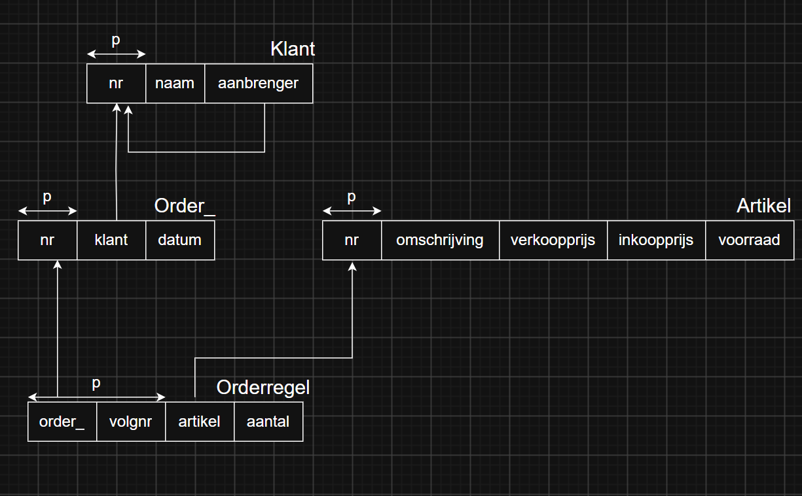
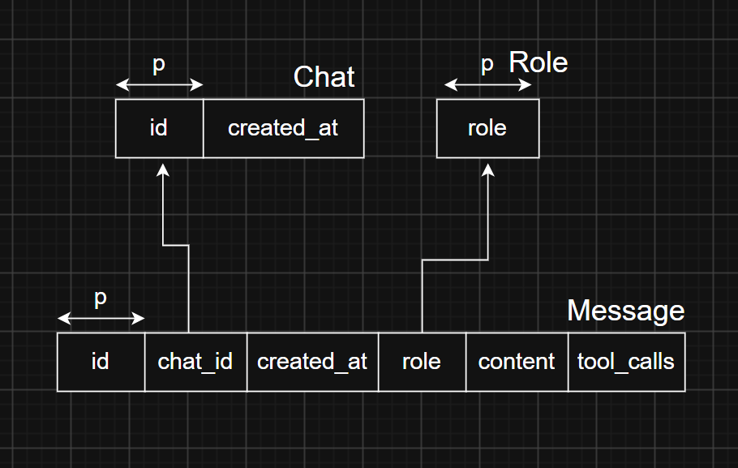

# Klant systeem

Fullstack applicatie met als hoofdfunctie het bevragen van een database met orders, klanten, orderregels en artikelen. Dit kan handmatig of met behulp van twee agents, waarbij één agent fungeert als gespreksagent, die op zijn beurt een andere agent kan aanroepen om in de database te kijken.

## Wat zit erin

### **Backend** (FastAPI)

#### ***agent_core***

| Functie | Bestand | 
|---|---|
| Klasse 'Agent' definiëren | [agent.py](backend/agent_core/agent.py) |
| Bewaren van systeemprompts | [prompts.py](backend/agent_core/prompts.py) |
| Definiëren van tools voor de gespreksagent | [agent_tools.py](backend/agent_core/tools/agent_tools.py) |
| Definiëren van tools voor de database-agent | [db_agent_tools.py](backend/agent_core/tools/db_agent_tools.py) |
| Hulpfuncties | [utils.py](backend/agent_core/tools/utils.py) |


#### ***databases*** 
(De links verwijzen naar order_db/, maar message_db/ deelt dezelfde structuur.)

| Functie | Bestand | 
|---|---|
| Functies voor verbinding met databases | [db_connection.py](backend/databases/db_connection.py)
| Aanmaken van de tabellen | [create.py](backend/databases/order_db/create.py) | 
| Vullen met data | [populate.py](backend/databases/order_db/populate.py) |
| Bewaren van queries | [queries.py](backend/databases/order_db/queries.py) |


#### ***routers***

| Functie | Bestand | 
|---|---|
| Modellen definiëren voor endpoints | [models.py](backend/routers/models.py) |
| Endpoint voor communicatie met agent | [agent_router.py](backend/routers/agent_router.py) |
| Endpoints voor het ophalen van data uit de database | [data_router.py](backend/routers/data_router.py) |
| Hulpfuncties | [utils.py](backend/routers/utils.py) |


#### ***testing***
| Functie | Bestand |
|---|---|
| Database-agent testen op een aantal vragen | [db_agent_test.py](backend/testing/agent_testing/db_agent_test.py) |
| Unit testing van losse functies en endpoints | backend/testing/unit_testing/ |

### **Frontend** (React)

#### ***sections***

 - [AgentSection.jsx](frontend/src/sections/AgentSection.jsx)
 - [DataSection.jsx](frontend/src/sections/DataSection.jsx)


#### ***data_components***

 - [Klant.jsx](frontend/src/components/data_components/Klant.jsx)
 - [Order.jsx](frontend/src/components/data_components/Order.jsx)
 - [Orderregel.jsx](frontend/src/components/data_components/Orderregel.jsx)
 - [Klanten.jsx](frontend/src/components/data_components/Klanten.jsx)
 - [Orders.jsx](frontend/src/components/data_components/Orders.jsx)
 - [Orderregels.jsx](frontend/src/components/data_components/Orderregels.jsx)


#### ***agent_components***

 - [ChatBar.jsx](frontend/src/components/agent_components/ChatBar.jsx)
 - [TextBubble.jsx](frontend/src/components/agent_components/TextBubble.jsx)
 

## Projectstructuur

```
klant-systeem/
├── backend/   
│    ├── agent_core/
│    │   ├── tools/
│    │   ├── agent.py
│    │   └── prompts.py
│    ├── databases/
│    │   ├── message_db/
│    │   ├── order_db/
│    │   └── db_connection.py
│    ├── routers/
│    │   ├── agent_router.py
│    │   ├── data_router.py
│    │   ├── models.py
│    │   └── utils.py
└── frontend/          
│    ├── src/
│    │   ├── assets/
│    │   ├── components/   
│    │   │   ├── agent_components/
│    │   │   └── data_components/   
│    │   ├── sections/    
│    │   ├── api.js
│    │   └── App.jsx
      
```

## Database-schema

### **Order Database**



### **Message Database**



## Zelf draaien

### Applicatie

(Je hebt ollama nodig om het agent-gedeelte te laten werken. Zelf heb ik gemma4:12b gebruikt, maar andere modellen kunnen ook gebruikt worden. Zet in een .env-bestand welk model je wilt gebruiken, net als in .env.example.)

```bash
git clone https://github.com/Timoasmus/klant-systeem
cd klant-systeem
pip install -r requirements.txt

cd backend
python main.py
```

***Nieuwe terminal*** (vanuit klant-systeem/)
```bash
cd frontend
npm install
npm run dev
```
Open daarna de url (http://localhost:5173) in de browser, waarna je de applicatie lokaal kan uitproberen.


### Testen 

 - Database agent testen (vanuit klant-systeem/backend/)
```bash
python -m testing.agent_testing.db_agent_test
```

 - Unit testing (vanuit klant-systeem/backend/)
```bash
pytest testing/unit_testing
```